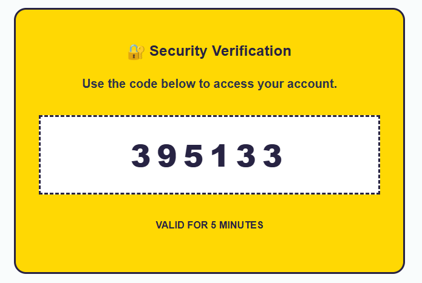

# ⚡ Secure Streamlit Authentication Portal

A robust, web-based authentication and analytics dashboard built entirely in Python using **Streamlit**. This project is designed to be easily deployed from a Google Colab notebook and exposed to the public internet using an **Ngrok** tunnel.

It features a custom Neo-Brutalist UI and a secure SQLite backend tailored for identity management, rate limiting, and password recovery via Email OTP.

---

## 🎨 User Interface (UI) Previews

The application features a clean, high-contrast Neo-Brutalist design with bold yellow buttons, dark drop shadows, and styled input fields. 

### 1. Sign In Page
The login screen provides a straightforward interface for returning users to enter their email and password, alongside quick navigation buttons to create an account or recover a lost password.
![Sign In Page][alt text](image.png)

### 2. Create an Account Page
The registration form captures the user's full name, email, and password (with a minimum 8-character requirement and confirmation field)[cite: 8]. It also requires the user to select and answer a security question (e.g., "What is your pet name?") for account recovery.

![Reset Password Page][alt text](image-1.png)

### 3. Password Recovery (Forgot Password)
When a user forgets their password, they simply enter their registered email address and can choose between two verification methods: "Via Security Question" or "Via OTP".

[alt text](image-2.png)

---

## 🔐 Features & Login Page Usage

This application provides a fully functional authentication system that prioritizes security. 

* **Sign Up & Login:** Users can create an account using their email address. Passwords are never stored in plain text; they are salted and hashed using **Bcrypt**.
* **JWT Session Management:** Upon successful login, a JSON Web Token (JWT) is generated with a 2-hour expiration, securely maintaining the user's active session across different pages.
* **Brute-Force Protection:** The backend tracks login attempts. If a user enters the wrong password **3 times in a row**, their account is temporarily **locked for 5 minutes**. 
* **Advanced Password Recovery:** 
  * **Security Question:** Users can recover accounts by answering a pre-set security question.
  * **Email OTP Verification:** Users can request a securely generated 6-digit OTP sent directly to their registered email via Gmail SMTP. The OTP expires in 5 minutes.
  
* **Password History Enforcement:** When resetting a password, the system checks the database password history to ensure the user is not reusing a previously used password.
* **Role-Based Dashboards:** 
  * Logging in as an Administrator (e.g., `infosys@ai`) opens a dedicated Admin Panel.
  * Standard users see an interactive Analytics Dashboard featuring Plotly charts.

---

## 🛠️ Setup Guide

To run this application in Google Colab, you need two secret keys: a **Google App Password** (to send OTP emails) and an **Ngrok Authtoken** (to host the website publicly). 

### Tutorial 1: How to get a Google App Password (For Email OTP)
Google blocks standard passwords for automated scripts. You must generate a secure "App Password" to allow your Python script to send OTP emails.

1. Go to your [Google Account Management](https://myaccount.google.com/).
2. Click on **Security** in the left-hand navigation menu.
3. Scroll down to the "How you sign in to Google" section.
4. Ensure **2-Step Verification** is turned **ON**. (You cannot create an App Password without this).
5. Use the search bar at the top of your Google Account and search for **"App passwords"**.
6. Under "Select app", choose **Other (Custom name)** and type something like `Streamlit OTP`.
7. Click **Generate**.
8. Google will display a **16-character password** in a yellow box. 
9. **Copy this password** exactly as it appears (without spaces). You will not be able to see it again.

### Tutorial 2: How to get an Ngrok Authtoken (For Web Hosting)
Ngrok creates a secure tunnel from the Google Colab server to the public internet, giving you a live URL for your Streamlit app.

1. Go to [ngrok.com](https://ngrok.com/) and create a free account (or log in).
2. On the left-hand dashboard menu, click on **Getting Started** > **Your Authtoken**.
3. You will see a long string of characters under "Your Authtoken".
4. Click the **Copy** button next to the token.

---

## 🚀 Deployment in Google Colab

Once you have both keys, you need to add them to your Google Colab environment so the script can access them securely.

### 1. Add Keys to Colab Secrets
1. Open your Google Colab notebook.
2. Click the **🔑 Secrets** icon on the far-left vertical toolbar.
3. Click **Add new secret**.
   * Name: `EMAIL_PASSWORD`
   * Value: *(Paste your 16-character Google App Password here)*
4. Click **Add new secret** again.
   * Name: `NGROK_AUTHTOKEN`
   * Value: *(Paste your Ngrok Authtoken here)*
5. **Crucial Step:** Toggle the switch in the **"Notebook access"** column for both secrets so they turn blue.

### 2. Update the Sender Email
In the `app.py` code block, find the `SENDER_EMAIL` variable and change it to the Gmail address you used to generate the App Password:
```python
SENDER_EMAIL = "your.email@gmail.com"